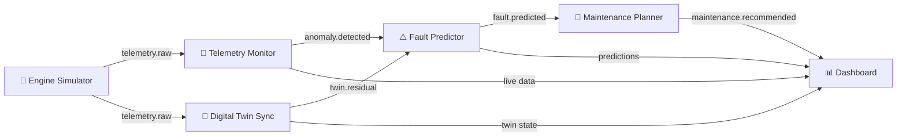
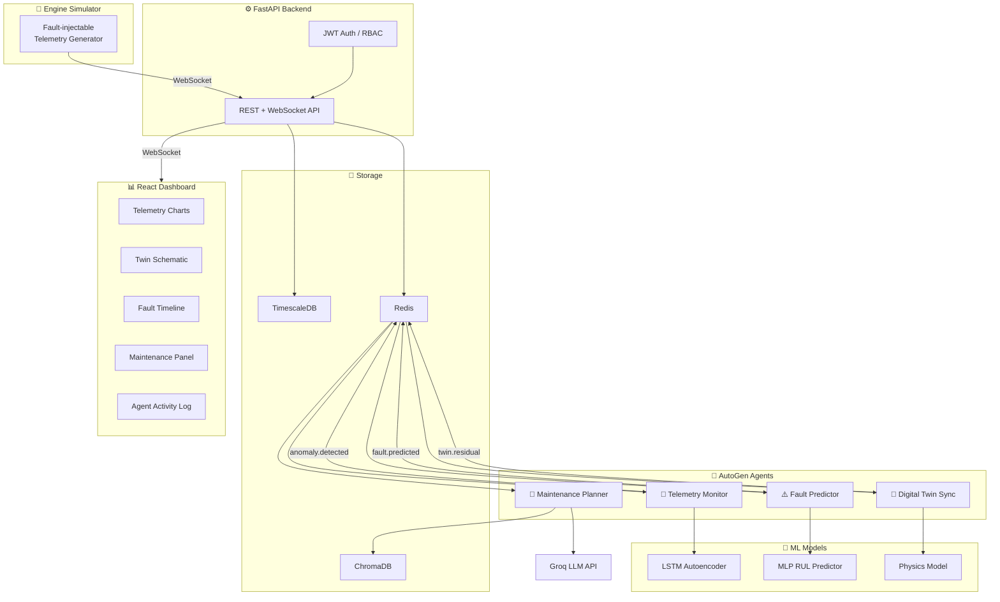

# 🛩️ AeroTwin — UAV Engine Digital-Twin Health Monitoring Agent
## Design Decisions Summary (SIH 2026 — SIH26054)

> [!IMPORTANT]
> **Solo developer, 3-day sprint, all free APIs.** Every decision below was made to maximize demo impact within these constraints.

---

## 1. Engine & Data Source

| Decision | Choice |
|---|---|
| **Engine type** | Small turbine/jet engine (JetCat P-series style) |
| **Data source** | Simulated telemetry with injected fault scenarios |
| **Sensor channels (6)** | EGT, RPM (N1/N2), Vibration, Fuel Flow, Oil Pressure & Temp, Ambient (OAT/Altitude) |

---

## 2. Digital Twin Approach

| Decision | Choice |
|---|---|
| **Modeling** | Physics-informed ML hybrid — simplified Brayton-cycle equations + ML residual correction |
| **Anomaly detection** | LSTM Autoencoder (learns "normal" → high reconstruction error = anomaly) |
| **RUL prediction** | Simple MLP on physics-informed features |

---

## 3. Multi-Agent Architecture

| Decision | Choice |
|---|---|
| **Framework** | AutoGen (Microsoft) — conversation-based multi-agent coordination |
| **Coordination** | Event-driven pub/sub via Redis |
| **Agent count** | 4 agents |

### Agent Roster

| Agent | Responsibility | Subscribes To | Publishes |
|---|---|---|---|
| **Telemetry Monitor** | Ingest sensor streams, detect threshold breaches & statistical anomalies | `telemetry.raw` | `anomaly.detected` |
| **Digital Twin Sync** | Maintain physics model state, compute expected-vs-actual residuals | `telemetry.raw` | `twin.residual`, `twin.drift` |
| **Fault Predictor** | Classify fault type, predict RUL (Remaining Useful Life) | `anomaly.detected`, `twin.residual` | `fault.predicted` |
| **Maintenance Planner** | Generate maintenance recommendations via RAG over procedures | `fault.predicted` | `maintenance.recommended` |



---

## 4. LLM & Embeddings

| Decision | Choice | Cost |
|---|---|---|
| **LLM** | Groq free tier — Llama 3.1 70B | Free (rate-limited) |
| **Embeddings** | Sentence-Transformers `all-MiniLM-L6-v2` (local) | Free (runs on CPU) |

---

## 5. Data & Storage

| Decision | Choice |
|---|---|
| **Time-series DB** | TimescaleDB (PostgreSQL extension) — hypertables for telemetry, regular tables for asset history |
| **Vector store (RAG)** | ChromaDB (in-process, Python-native) |
| **Message broker** | Redis Pub/Sub + Streams |
| **RAG content** | Synthetic maintenance manuals (custom-written, matches fault scenarios) |

---

## 6. Tech Stack

| Layer | Technology |
|---|---|
| **Backend** | Python + FastAPI (async) |
| **Frontend** | React / Next.js |
| **ML** | PyTorch (LSTM Autoencoder + MLP) |
| **Agents** | AutoGen + Groq LLM |
| **RAG** | ChromaDB + MiniLM embeddings |
| **Database** | TimescaleDB (PostgreSQL) |
| **Messaging** | Redis |
| **Deployment** | Docker Compose (single `docker compose up`) |

---

## 7. Dashboard Panels (5 core)

1. **📈 Real-time Telemetry** — Live gauges/charts for all 6 sensor channels
2. **🧬 Digital Twin Schematic** — 2D SVG engine cross-section with highlighted fault zones
3. **⏳ Fault Prediction Timeline** — RUL countdown + fault type classification
4. **🔧 Maintenance Recommendations** — RAG-sourced procedures with document citations
5. **🤖 Agent Activity Log** — Live trace of agent conversations and events

---

## 8. Demo Scenarios (4 pre-scripted)

| # | Scenario | Trigger | Expected Agent Behavior |
|---|---|---|---|
| 1 | ✅ Normal Operation | Default | Twin tracks sensors, no anomalies, green status |
| 2 | 🔴 Gradual Bearing Wear | Button | Vibration ↑ slowly → anomaly → RUL countdown → bearing inspection procedure |
| 3 | 🟠 Sudden Compressor Stall | Button | RPM spike + EGT surge → immediate alert → emergency procedure |
| 4 | 🟡 Fuel Nozzle Clogging | Button | Fuel flow ↓ + EGT imbalance → fault prediction → nozzle cleaning procedure |

---

## 9. Access Control

| Role | Permissions |
|---|---|
| **Operator** | View telemetry, view alerts (read-only) |
| **Maintenance Engineer** | View + approve/reject maintenance recommendations |
| **Admin** | Full access + system configuration + user management |

Auth: JWT-based, simple login page, role stored in token claims.

---

## 10. Observability

- Structured JSON logging across all services
- Agent activity trace panel in dashboard
- Request/response logging for all API endpoints

---

## 11. Deployment

```yaml
# docker-compose.yml services:
services:
  - api         # FastAPI backend
  - frontend    # React/Next.js dashboard
  - timescaledb # PostgreSQL + TimescaleDB
  - redis       # Pub/Sub + Streams
  - simulator   # Engine telemetry simulator
```

> [!TIP]
> **One-command launch:** `docker compose up --build` starts everything. Judges can clone the repo and run it in under 2 minutes.

---

## 12. 3-Day Sprint Plan

### Day 1 — Foundation & Data Pipeline
- Project scaffolding (monorepo structure, Docker Compose)
- Engine simulator with 6 sensor channels + fault injection
- TimescaleDB schema + FastAPI telemetry ingestion API
- Redis pub/sub setup
- Basic React dashboard skeleton with live telemetry charts

### Day 2 — Agents & ML
- LSTM Autoencoder training on simulated normal data
- MLP RUL predictor
- Physics-informed digital twin baseline model
- AutoGen agent setup (4 agents with tools)
- RAG pipeline: synthetic maintenance docs → ChromaDB → Maintenance Planner
- Agent event-driven coordination via Redis

### Day 3 — Integration, Polish & Demo Prep
- Dashboard: twin schematic, fault timeline, maintenance panel, agent log
- RBAC (JWT auth + 3 roles)
- 4 demo scenarios wired to UI buttons
- Docker Compose full integration test
- README, demo script, presentation prep

---

## Architecture Diagram



